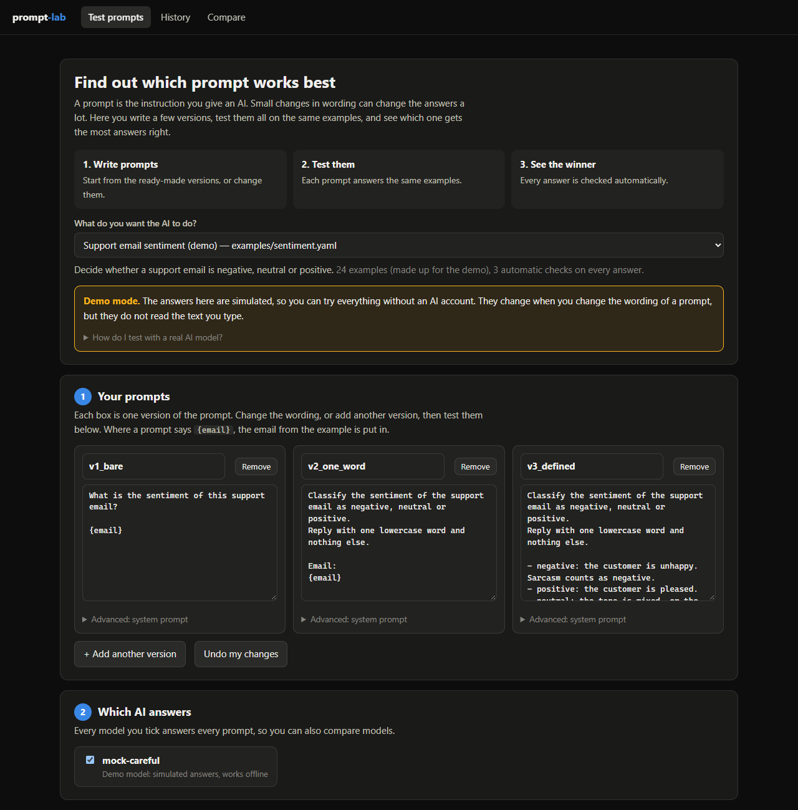
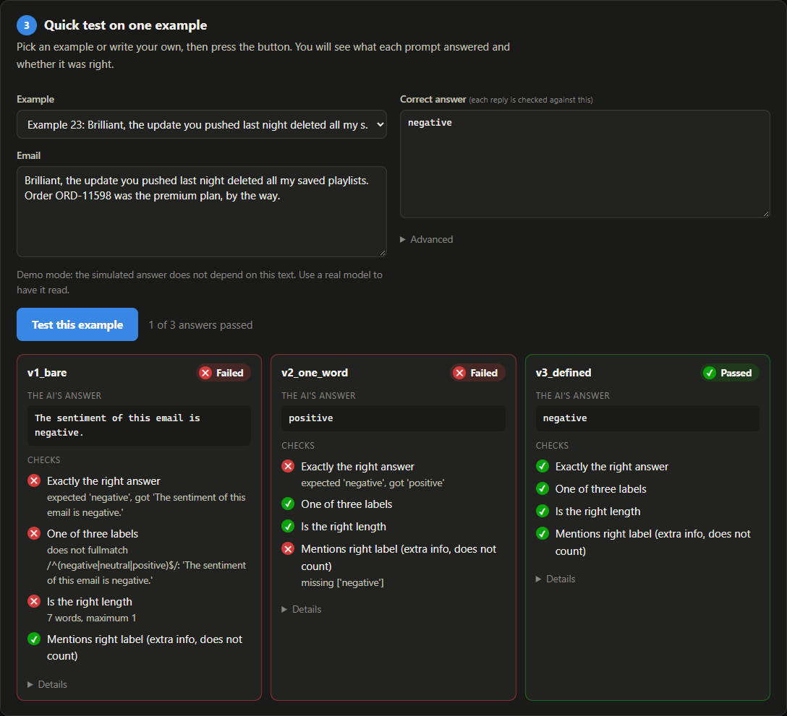
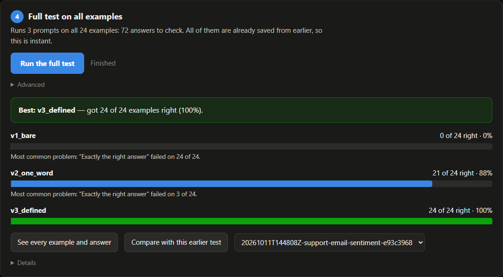
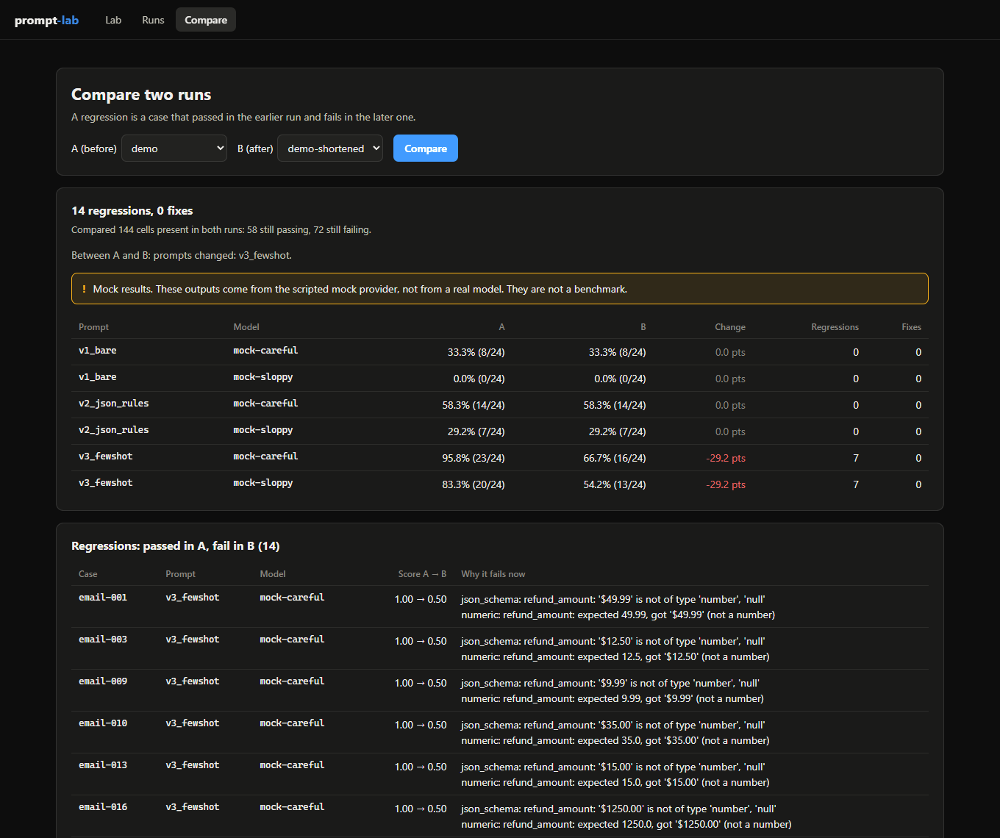
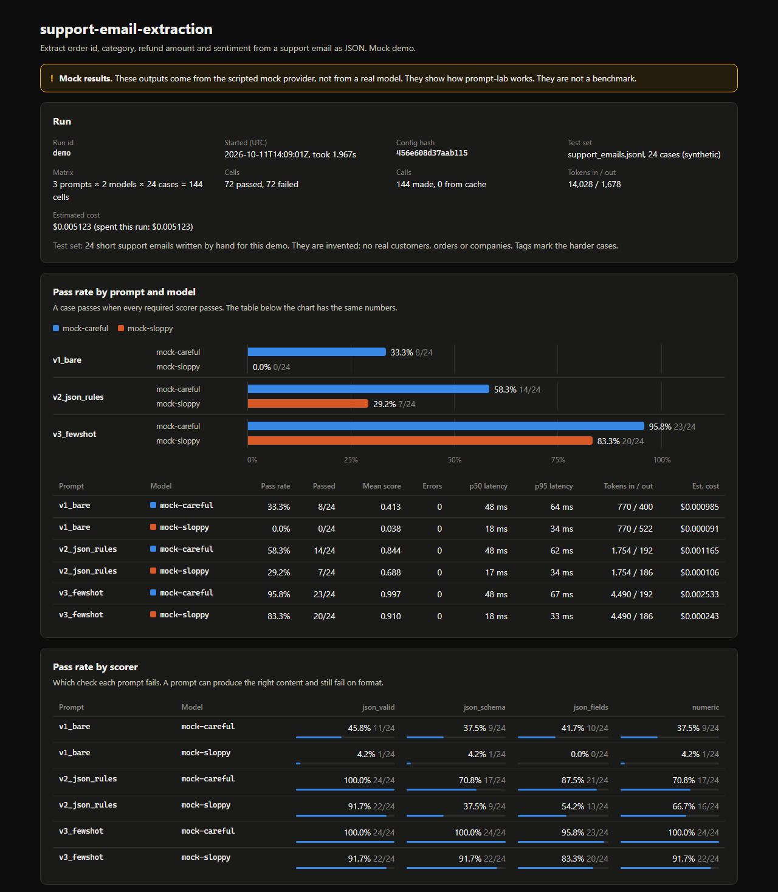
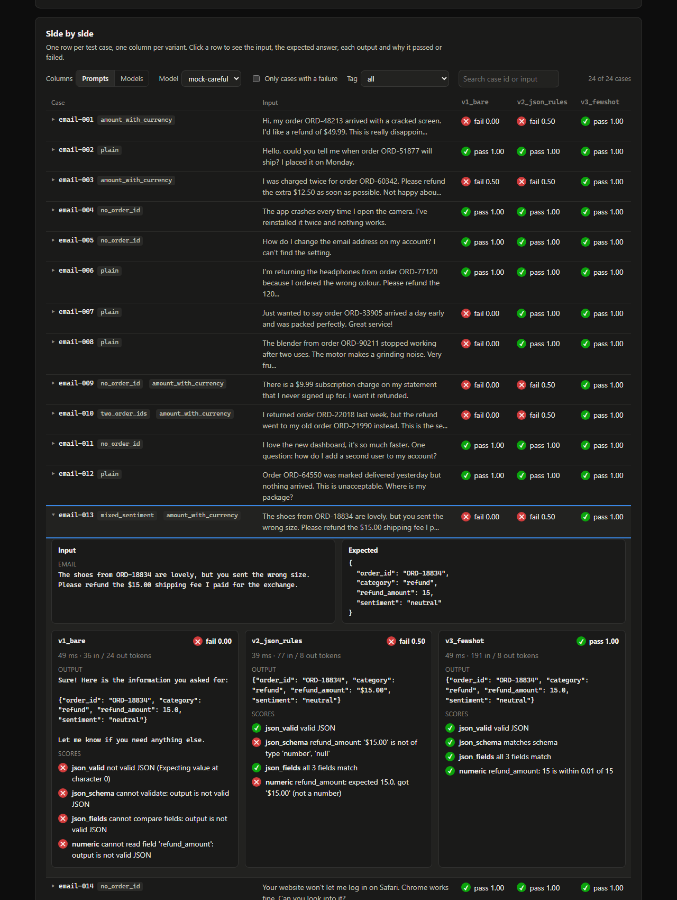
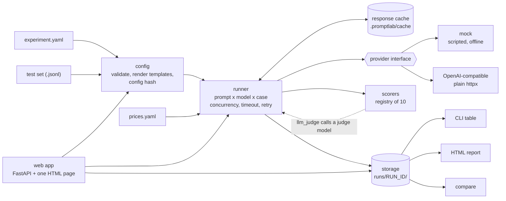

# prompt-lab

[](https://github.com/Omkar210404/Prompt-Lab/actions/workflows/ci.yml)


A small evaluation tool for LLM prompts. It runs several prompt variants (and optionally several models) over a test set, scores every output with pluggable scorers, saves the run, and shows the results side by side. It can also diff two runs and list the cases that passed before and fail now. Use it from a local web app or from the command line.



> **The screenshots and numbers in this README are mock results.** They come from a scripted, offline mock provider, not from a real model. They show how the tool works. They are not a benchmark of any model. See [What the demo is](#what-the-demo-is).

## The problem

Changing a prompt is easy. Knowing whether the change made things better is not. The usual method is to try three inputs by hand, like what you see, and ship it. That misses the cases you didn't try, and it gives you nothing to compare against next week when someone edits the prompt again.

## Why prompts should be evaluated

- **A prompt is code that fails silently.** A badly worded instruction doesn't raise an error. It returns `"$49.99"` where your program expects `49.99`, on some inputs and not others.
- **Fixes cause regressions.** Shortening a prompt to save tokens can break a case it used to handle. You only see that if you re-run the same cases and compare.
- **"It looks right" hides format failures.** An answer can have the right content and still be useless to the code that parses it. Scoring content and format separately shows which one failed.
- **Cost and latency are part of quality.** A longer prompt may pass more cases and cost three times as much. You need both numbers next to each other to decide.

## What it does

- **A local web app.** Edit prompts in the browser, try them on one input, run the whole test set with a progress bar, and compare runs.
- **Experiments in YAML.** A name, prompt templates with `{variables}`, a JSONL test set, and the models to run.
- **Runs the full matrix.** Every prompt × model × test case, with a concurrency limit, per-call timeouts and retries with backoff.
- **Caches responses on disk.** A re-run does not repeat calls that were already paid for.
- **Ten scorers.** Exact match, contains, not-contains, regex, length, JSON validity, JSON Schema, per-field JSON comparison, numeric tolerance, and an optional LLM judge.
- **Records latency, tokens and estimated cost.** Tokens only when the provider reports them. Cost from a price table you edit.
- **Saves every run.** `results.jsonl` plus `summary.json`, with the config hash and timestamp.
- **Reports.** A terminal table, and a self-contained HTML report with a chart, a side-by-side grid, a per-case drill-down and the worst failures.
- **Compares two runs** and lists regressions, with a `--fail-on-regression` exit code for CI.
- **Runs offline.** A deterministic mock provider drives the demo and all 279 tests. No key or network is needed.

## Quick start

Requires Python 3.11 or newer.

```bash
git clone https://github.com/Omkar210404/Prompt-Lab.git
cd Prompt-Lab
python -m venv .venv
.venv\Scripts\activate            # Windows.  macOS/Linux: source .venv/bin/activate
pip install -r requirements.txt
pip install -e . --no-deps
```

### The web app

```bash
prompt-lab ui
```

```text
prompt-lab is running at http://127.0.0.1:8321  (press Ctrl+C to stop)
```

It opens in your browser. The page is written for someone who has never used the tool: it uses plain words ("examples", "checks", "got worse") and keeps the technical details behind **Details** and **Advanced**. The demo tasks use the mock provider, shown in the app as **Demo mode**, so they need no API key.

Pick a task at the top, then follow four steps:

1. **Your prompts.** Each version is a box you can edit, rename, remove or copy. Edits stay in the page; they are not written back to the experiment file.
2. **Which AI answers.** Tick the models to use. A model whose API key is not set is shown as not ready.
3. **Quick test on one example.** Pick an example or write your own, and press **Test this example**. Each prompt's answer appears side by side, marked Passed or Failed, with every check listed in plain words.
4. **Full test on all examples.** Press **Run the full test**. A progress bar runs, then the page names the best prompt and shows a bar for each one, with its most common problem. The test is saved, with the prompts as you edited them.





The **History** tab lists saved tests and opens the full report for each. The **Compare** tab shows what got worse and what got better between two tests:



In demo mode, the answer does not depend on the text you type. The mock builds it from the correct answer and the scripted rules, and the app says so next to the input box. What does change the result is the wording of your prompts, because some rules look for it. In the "Support email extraction" task, add `Respond with only a JSON object.` to `v1_bare`, press **Run the full test**, and it goes from 8 of 24 right to 14 of 24 for `mock-careful`. To have your typed input read and answered, use a real model: see [Using a real model](#using-a-real-model).

The app is for your own machine. It listens on `127.0.0.1` only and refuses requests that come from other sites' pages, because a run can spend money on model calls.

### The command line

Run the demo. It uses the mock provider, so it needs no API key:

```bash
prompt-lab run examples/support_extraction.yaml --name demo --html
```

```text
support-email-extraction: 3 prompts x 2 models x 24 cases = 144 calls (0 cached, 144 to make)

Run:         demo
Experiment:  support-email-extraction
Started:     2026-10-11T14:09:01+00:00   (1.967s)
Config hash: 456e608d37aa
Test set:    support_emails.jsonl, 24 cases (synthetic)

MOCK RESULTS. These outputs come from the scripted mock provider, not from a real model. They show how prompt-lab works. They are
not a benchmark.

Results by prompt and model

  Prompt          Model          Pass rate   Passed   Score   Errors     p50   Tokens in / out   Est. cost
 ──────────────────────────────────────────────────────────────────────────────────────────────────────────
  v1_bare         mock-careful       33.3%     8/24   0.413        0   48 ms         770 / 400   $0.000985
  v1_bare         mock-sloppy         0.0%     0/24   0.038        0   18 ms         770 / 522   $0.000091
  v2_json_rules   mock-careful       58.3%    14/24   0.844        0   48 ms       1,754 / 192   $0.001165
  v2_json_rules   mock-sloppy        29.2%     7/24   0.688        0   17 ms       1,754 / 186   $0.000106
  v3_fewshot      mock-careful       95.8%    23/24   0.997        0   48 ms       4,490 / 192   $0.002533
  v3_fewshot      mock-sloppy        83.3%    20/24   0.910        0   18 ms       4,490 / 186   $0.000243

Pass rate by scorer

  Prompt          Model          json_valid   json_schema   json_fields   numeric
 ─────────────────────────────────────────────────────────────────────────────────
  v1_bare         mock-careful        45.8%         37.5%         41.7%     37.5%
  v1_bare         mock-sloppy          4.2%          4.2%          0.0%      4.2%
  v2_json_rules   mock-careful       100.0%         70.8%         87.5%     70.8%
  v2_json_rules   mock-sloppy         91.7%         37.5%         54.2%     66.7%
  v3_fewshot      mock-careful       100.0%        100.0%         95.8%    100.0%
  v3_fewshot      mock-sloppy         91.7%         91.7%         83.3%     91.7%

Cells: 144 (72 passed, 72 failed, 0 errors)
Calls: 144 made, 0 from cache
Est. cost: $0.005123 (spent this run: $0.005123)

Saved: runs/demo
HTML report: runs/demo/report.html
```

Open `runs/demo/report.html` in a browser, or run `prompt-lab report demo --open`. That run is committed in this repository, so after cloning you can open `runs/demo/report.html` without running anything.

Run it a second time and every call comes from the cache:

```text
support-email-extraction: 3 prompts x 2 models x 24 cases = 144 calls (144 cached, 0 to make)
...
Calls: 0 made, 144 from cache
Est. cost: $0.005123 (spent this run: $0)
```

### The HTML report

Every run can be written out as one HTML file with CSS, JavaScript and data inline, so it opens offline and can be emailed or attached to a pull request. The web app serves the same report for each saved run.



Click a test case to see its input, the expected answer, each variant's output and the reason every scorer gave:



It also has a model switcher, a prompts/models toggle for the columns, filters for failed cases and tags, a list of the worst failures, and the prompt templates exactly as they were run. Both screenshots were taken from `runs/demo/report.html` with headless Chrome.

### What the demo is

The test set is 24 short support emails that I wrote by hand. They are synthetic: no real customers, orders or companies. Each has an expected answer with four fields (`order_id`, `category`, `refund_amount`, `sentiment`), and tags mark the harder cases, such as an email with two order numbers.

The three prompts ask for the same thing with increasing care:

| Prompt | What it adds |
|---|---|
| `v1_bare` | Says what to extract. Nothing about the format. |
| `v2_json_rules` | "Respond with only a JSON object", the exact keys, and the allowed values. |
| `v3_fewshot` | Rules for the edge cases (missing order id, number format, mixed tone) and two worked examples. |

The two "models" are the mock provider with different rule sets. **The mock does not generate text.** It starts from each case's expected answer and applies scripted rules written in [examples/support_extraction.yaml](examples/support_extraction.yaml). For example:

```yaml
- name: keeps-currency-symbol               # "$49.99" unless told to return a plain number
  when: { prompt_lacks: "plain number", tags: [amount_with_currency] }
  behave: number_as_string
  field: refund_amount
```

So the gap between the prompts is explainable, because I authored it: `v1_bare` fails `json_valid` because a rule wraps the answer in prose when the prompt doesn't say "only a JSON object"; `v2_json_rules` fixes that but still fails `numeric` on amounts with a currency symbol; `v3_fewshot` fixes those, and what's left are mistakes the rules apply whatever the prompt says, such as reading sarcasm as positive. The rules imitate common failure modes. They are not measurements of any model, and the pass rates above say nothing about real model quality.

## Finding regressions

`examples/support_extraction_shortened.yaml` is the same experiment with one edit: `v3_fewshot` was shortened to save tokens, dropping the number-format rule and the two examples.

```bash
prompt-lab run examples/support_extraction_shortened.yaml --name demo-shortened
prompt-lab compare demo demo-shortened --limit 4
```

```text
A (before): demo   2026-10-11T14:09:01+00:00   config 456e608d
B (after):  demo-shortened   2026-10-11T14:09:05+00:00   config dbf66df0
Between A and B: prompts changed: v3_fewshot

MOCK RESULTS. These outputs come from the scripted mock provider, not from a real model. They show how prompt-lab works. They are
not a benchmark.

Pass rate by prompt and model (cells present in both runs)

  Prompt          Model                      A               B      Change   Regressions   Fixes
 ────────────────────────────────────────────────────────────────────────────────────────────────
  v1_bare         mock-careful    33.3% (8/24)    33.3% (8/24)     0.0 pts             0       0
  v1_bare         mock-sloppy      0.0% (0/24)     0.0% (0/24)     0.0 pts             0       0
  v2_json_rules   mock-careful   58.3% (14/24)   58.3% (14/24)     0.0 pts             0       0
  v2_json_rules   mock-sloppy     29.2% (7/24)    29.2% (7/24)     0.0 pts             0       0
  v3_fewshot      mock-careful   95.8% (23/24)   66.7% (16/24)   -29.2 pts             7       0
  v3_fewshot      mock-sloppy    83.3% (20/24)   54.2% (13/24)   -29.2 pts             7       0

Regressions: passed in A, fail in B (showing 4 of 14)

  Case        Prompt       Model          Score A -> B   Why it fails now
 ─────────────────────────────────────────────────────────────────────────────────────────────────────────────────────────────
  email-001   v3_fewshot   mock-careful   1.00 -> 0.50   json_schema: refund_amount: '$49.99' is not of type 'number', 'null'
                                                         numeric: refund_amount: expected 49.99, got '$49.99' (not a number)
  email-003   v3_fewshot   mock-careful   1.00 -> 0.50   json_schema: refund_amount: '$12.50' is not of type 'number', 'null'
                                                         numeric: refund_amount: expected 12.5, got '$12.50' (not a number)
  email-009   v3_fewshot   mock-careful   1.00 -> 0.50   json_schema: refund_amount: '$9.99' is not of type 'number', 'null'
                                                         numeric: refund_amount: expected 9.99, got '$9.99' (not a number)
  email-010   v3_fewshot   mock-careful   1.00 -> 0.50   json_schema: refund_amount: '$35.00' is not of type 'number', 'null'
                                                         numeric: refund_amount: expected 35.0, got '$35.00' (not a number)

Compared 144 cells: 14 regressions, 0 fixes, 58 still passing, 72 still failing.
```

`compare` matches cells on case, prompt and model. It names what was edited between the runs, warns when the test sets differ, and computes pass rates only over cells both runs have. With `--fail-on-regression` it exits with code 1 when any case regressed, so a CI job can block a prompt change that breaks something. `--json` prints the whole comparison for other tools.

## Architecture



| Module | Responsibility |
|---|---|
| `config.py` | Pydantic models, YAML and JSONL loading, template rendering, load-time validation, the config hash |
| `providers/` | The `Provider` interface, the mock, the OpenAI-compatible provider, the retry loop |
| `scorers/` | The `Scorer` interface, a registry, and the ten built-in scorers |
| `runner.py` | Builds the matrix and runs it: concurrency limits, timeouts, cache lookups, scoring |
| `cache.py`, `pricing.py` | On-disk response cache; cost estimate from the price table |
| `storage.py`, `summary.py` | Run directories, `results.jsonl`, `summary.json`, aggregation |
| `report/`, `compare.py` | Terminal tables, the HTML report, the run diff |
| `cli.py` | `init`, `run`, `report`, `compare`, `list`, `ui` |
| `ui/` | The local web app: a FastAPI server over the same modules, and one HTML page with no build step |

A few decisions worth knowing:

- **A failed call never aborts a run.** It is saved as an error row and counted as a failure, so one timeout does not throw away the other outputs.
- **Generation and scoring are separate.** Responses are cached; scores are not. Changing a scorer and re-running costs nothing.
- **The concurrency slot is held only for the model call**, never while scoring, so a judge call made during scoring cannot deadlock against the cells waiting on it.
- **Model output is treated as untrusted** in the HTML report. It is inserted as text, never as HTML.

## Commands

| Command | What it does |
|---|---|
| `prompt-lab ui` | Opens the web app. `--port`, `--root DIR`, `--no-open` |
| `prompt-lab init [DIR]` | Writes a starter experiment, test set, price table and `.env.example` |
| `prompt-lab run EXPERIMENT.yaml` | Runs the matrix, saves the run, prints the tables |
| `prompt-lab report [RUN]` | Shows a saved run. `--html` writes the report, `--open` opens it, `--failures N` lists the worst failures |
| `prompt-lab compare RUN_A RUN_B` | Diffs two runs. `--fail-on-regression`, `--json` |
| `prompt-lab list` | Lists saved runs. `--scorers` lists the scorer types |

`RUN` is a run id, a unique prefix of one, a path, or `latest`. Useful `run` flags:

| Flag | Effect |
|---|---|
| `--dry-run` | Prints how many calls would be made and how many are cached, then stops. Use it before a paid run. |
| `--limit N`, `--prompt ID`, `--model ID` | Run part of the matrix. The run is marked as partial. |
| `--name NAME` | A fixed folder name instead of a timestamp. Replaces an earlier run with that name. |
| `--no-cache`, `--refresh` | Skip the cache, or ignore stored responses and overwrite them. |
| `--concurrency N` | Overrides the experiment file. |

`python -m promptlab` works in place of `prompt-lab`.

## Experiment file

```yaml
name: support-email-extraction
dataset: datasets/support_emails.jsonl      # paths are relative to this file

prompts:
  - id: v2_json_rules
    system: You are a support-ticket parser.   # optional
    template: |
      Respond with only a JSON object ...
      Email:
      {email}

models:
  - id: mock-careful
    provider: mock
    mock: { rules: [...] }
  - id: my-model
    provider: openai_compatible
    model: <model name>
    base_url: https://api.groq.com/openai/v1
    api_key_env: GROQ_API_KEY        # the NAME of the variable, never the key
    params: { temperature: 0, max_tokens: 300 }
    concurrency: 2                   # optional per-model limit for strict free tiers

scorers:                             # run on every test case
  - type: json_valid
  - type: json_schema
    schema_file: schemas/ticket.schema.json
  - type: numeric
    field: refund_amount
    abs_tol: 0.01

run: { concurrency: 4, timeout_seconds: 30, max_retries: 2 }
prices_file: prices.yaml
```

A test set is JSON Lines, one case per line:

```json
{"id": "email-001", "vars": {"email": "Hi, my order ORD-48213 arrived with a cracked screen. I'd like a refund of $49.99."}, "expected": {"order_id": "ORD-48213", "category": "refund", "refund_amount": 49.99, "sentiment": "negative"}, "tags": ["amount_with_currency"]}
```

- `expected` can be a string or an object. `checks` adds scorers for that one case. A line `{"_meta": {...}}` describes the set and is not a case.
- **Templates:** only `{name}` is substituted, where `name` is a plain identifier. JSON examples in a few-shot prompt, such as `{"order_id": "ORD-1"}`, are left alone. Write `{{name}}` for a literal `{name}`.
- **Problems are caught before any call is made:** a variable no test case provides, duplicate ids, an unknown scorer or option, a bad JSONL line (reported with its line number), a missing API key.

## Scorers

A test case passes when every required scorer passes. Its score is the mean of its scorers' scores. Add `required: false` to a scorer to report it without letting it fail the case.

| Type | Passes when | Main options |
|---|---|---|
| `exact_match` | output equals the expected value | `ignore_case`, `normalize_whitespace`, `expected_field`, `field` |
| `contains` | the text is present | `value` / `values`, `mode: all\|any`, `ignore_case` |
| `not_contains` | the text is absent | `value` / `values`, `ignore_case` |
| `regex` | the pattern matches | `pattern`, `mode: search\|match\|fullmatch`, `ignore_case` |
| `length` | length is within limits | `min_chars`, `max_chars`, `min_words`, `max_words` |
| `json_valid` | the whole output parses as JSON | `allow_fenced`, `require_object` |
| `json_schema` | the output validates against a JSON Schema | `schema` or `schema_file` |
| `json_fields` | listed fields equal the expected object (partial credit) | `fields`, `ignore_case` |
| `numeric` | a number is within tolerance | `abs_tol`, `rel_tol`, `field`, `coerce` |
| `llm_judge` | a judge model says the output meets a rubric | `rubric`, `judge`, `scale: binary\|1-5`, `threshold` |

`json_valid` is strict on purpose: JSON with a friendly sentence in front of it is not valid JSON to the program that has to parse it. `field: refund_amount` makes a scorer look at one field of a JSON output.

### LLM-as-judge, and its limits

Some qualities can't be checked with a regex: tone, whether a summary is faithful, whether an answer is helpful. `llm_judge` asks a second model to apply a rubric you write:

```yaml
judges:
  - id: judge
    provider: openai_compatible
    model: <a different model from the one under test, ideally a stronger one>
    base_url: https://api.groq.com/openai/v1
    api_key_env: GROQ_API_KEY

scorers:
  - type: length              # deterministic checks first
    max_words: 120
  - type: llm_judge
    judge: judge
    rubric: |
      Pass only if the reply (1) apologises once, (2) names one concrete next step,
      and (3) makes no promise about refunds.
```

A judge is a model, and it has a model's faults:

- **Bias.** Judges tend to favour longer, more confident answers. They also tend to rate their own output, or output from the same model family, more kindly.
- **Variance.** The same output can get a different verdict on a second call. The wording of the rubric can change the result too.
- **No ground truth.** A judge's pass rate is an opinion. It can be wrong in the same direction on every case, which no amount of averaging fixes.
- **It can be talked to.** The output being graded may contain text that reads like an instruction to the grader.

What prompt-lab does about it, and what you should do:

| prompt-lab does | You should |
|---|---|
| Runs the judge at temperature 0 unless you say otherwise | Use deterministic scorers for everything they can check, and the judge only for the rest |
| Asks for reasoning first, then a verdict, as JSON; the default scale is binary | Write rubrics as specific, checkable conditions. Avoid "rate the quality from 1 to 10" |
| Records an unusable judge reply as a **judge error**, shown separately. It is never guessed into a pass or a fail | Use a different model as the judge. prompt-lab warns when the judge is a model under test |
| Stores the judge's reasoning for every case and shows it in the report | Hand-label 20 to 30 cases and check that the judge agrees with you before trusting its pass rate |
| Reports judge calls, tokens and cost apart from the models under test | Treat small differences between two prompts as noise unless they hold up on a re-run with `--refresh` |
| Tells the judge to ignore instructions inside the output it grades | Read the failures. A judge's verdict is a pointer to cases worth reading, not a replacement for reading them |

The demo's numbers use deterministic scorers only. `llm_judge` is covered by tests with the mock provider standing in for the judge. I have not run it against a live judge model.

## Tokens, cost and the price table

- **Latency** is measured around each call.
- **Token counts** are stored only when the provider reports them. If it doesn't, they are `n/a`. The mock reports word counts so the demo has something to show.
- **Cost** is an estimate: reported tokens × the prices in your price table, in USD per 1M tokens.

```yaml
# prices.yaml
your-model-name:
  input: 0.00
  output: 0.00
  source: <pricing page URL>
  checked: <date you read it>
```

prompt-lab ships **no real provider prices**, because they change and a stale number in a repository is a false claim. The prices in `examples/prices.yaml` are fictional and labelled as such. A model with no entry, or a call with no reported tokens, gets a cost of `n/a`, never `$0`. The entries used for a run are copied into its `summary.json`.

## What a run saves

```text
runs/demo/
├── results.jsonl     one line per prompt x model x test case
├── summary.json      totals, per-prompt and per-scorer pass rates, config hash, timestamps, prices used
├── experiment.yaml   the experiment exactly as it was run
├── dataset.jsonl     the test set exactly as it was run
├── prices.yaml, schemas/   files the run read
└── report.html       written by --html
```

One line of `results.jsonl`, shortened:

```json
{"case_id": "email-001", "prompt_id": "v1_bare", "model_id": "mock-careful", "status": "ok",
 "output": "Sure! Here is the information you asked for:\n\n{\"order_id\": \"ORD-48213\", ...",
 "latency_ms": 51.11, "cached": false, "attempts": 1,
 "usage": {"prompt_tokens": 32, "completion_tokens": 24}, "cost_usd": 5.2e-05,
 "passed": false, "score": 0.0,
 "scores": [{"scorer": "json_valid", "passed": false, "score": 0.0,
             "reason": "not valid JSON (Expecting value at character 0)"}, ...]}
```

The **config hash** covers everything that decides the outputs and the scores: prompts, models, params, mock rules, judges, scorers, the test set and any schema files. It leaves out concurrency, timeouts and prices. Two runs with the same hash measured the same thing. A run directory is self-contained: `prompt-lab run runs/demo/experiment.yaml` repeats it and arrives at the same hash.

`runs/` is ignored by git except the two demo runs. The cache lives in `.promptlab/cache/` and is also ignored.

## Using a real model

Any OpenAI-compatible Chat Completions API works: OpenAI, Groq, OpenRouter, Together, a local Ollama server.

1. Copy `.env.example` to `.env` and set the key. Keys are read only from environment variables; an experiment file holds the variable's name, never the key.
2. Add the model to an experiment (see [Experiment file](#experiment-file)) and its prices to the price table. `examples/support_extraction_real.yaml` is the demo experiment already set up for two models on Groq; it needs `GROQ_API_KEY`.
3. In the web app, pick that experiment and use **Try one input**: a real model reads what you type. Or from the command line, check the size of the run, try a few cases, then run it all:

```bash
prompt-lab run my_experiment.yaml --dry-run
prompt-lab run my_experiment.yaml --limit 5
prompt-lab run my_experiment.yaml
```

**Status:** the OpenAI-compatible provider is tested against a fake HTTP transport for success, 401, 403, 429 with `Retry-After`, 5xx, timeouts and malformed bodies. As of 2026-10-11 I have not run it, or `support_extraction_real.yaml`, against a live API, so this README contains no real-model results. If I add some later, they will state the date, the model names and the test set size, and that 24 cases is a small test, not a benchmark.

## Extending it

### Add a scorer

Subclass `Scorer`, set `type`, take options as keyword arguments, and return a `ScoreResult`:

```python
# promptlab/scorers/starts_with.py
from promptlab.config import TestCase
from promptlab.scorers.base import ScoreResult, Scorer, failed, passed, register_scorer


@register_scorer
class StartsWith(Scorer):
    """Output starts with the given prefix."""

    type = "starts_with"

    def __init__(self, prefix: str, ignore_case: bool = False):
        self.prefix = prefix
        self.ignore_case = ignore_case

    def score(self, output: str, case: TestCase) -> ScoreResult:
        text, prefix = (output.lower(), self.prefix.lower()) if self.ignore_case else (output, self.prefix)
        if text.startswith(prefix):
            return passed(f"starts with {self.prefix!r}")
        return failed(f"does not start with {self.prefix!r}")
```

Import the module in `promptlab/scorers/__init__.py` so it registers, and it is available as `type: starts_with`. A misspelled option in the YAML becomes a load-time error. If a scorer raises, the run records a scorer error for that cell and carries on.

### Add a provider

Subclass `Provider` and implement `from_config` and one async method. Raise `ProviderError` subclasses so the retry loop knows what is worth retrying:

```python
# promptlab/providers/echo.py
import time

from promptlab.config import ModelConfig
from promptlab.providers.base import CompletionRequest, CompletionResponse, Provider
from promptlab.providers.registry import register_provider


@register_provider
class EchoProvider(Provider):
    """Returns the prompt unchanged. Useful for checking templates."""

    type = "echo"

    @classmethod
    def from_config(cls, config: ModelConfig) -> "EchoProvider":
        return cls(model=config.model)

    async def complete(self, request: CompletionRequest) -> CompletionResponse:
        started = time.perf_counter()
        return CompletionResponse(
            text=request.prompt,
            model=self.model,
            latency_ms=(time.perf_counter() - started) * 1000,
            usage=None,  # no token counts reported, so cost shows as n/a
        )
```

Import it in `promptlab/providers/__init__.py`, then use `provider: echo`. If a provider's answer depends on more than the model, prompt and params, override `cache_key_parts` so the cache key covers it. The mock does this for its rules.

## Tests

```bash
pip install -r requirements-dev.txt
pytest -q
```

```text
279 passed in 27.03s
```

Every test runs offline. A fixture refuses any network connection that leaves the machine, so a test that tried to reach an API would fail. Covered: each scorer, the runner (concurrency limits, timeouts, retries, error containment), the cache, cost estimation, storage, the HTML report (including escaping of hostile model output), `compare`, the CLI end to end, and the web app's server (trying an input, edited prompts, background runs, and refusing cross-site requests). The web page itself was checked by hand and with a scripted browser session, not by the test suite. GitHub Actions runs the tests and the mock demo on every push.

## Limitations

- **The demo proves the tool, not any model.** Its results are scripted. I have not run prompt-lab against a live model or a live judge.
- **Small test sets give noisy numbers.** With 24 cases, one case is 4.2 points of pass rate. There are no confidence intervals and no repeated sampling.
- **One sample per cell.** A model at temperature above 0 can answer differently each time; prompt-lab runs each cell once, and the cache then freezes that answer until you use `--refresh`.
- **The cache can't see changes it wasn't told about.** If a provider changes a model behind the same name, cached responses stay as they were.
- **Single-turn prompts only.** One optional system prompt and one user message. No multi-turn conversations, tools or images.
- **Cost is an estimate.** It depends on your price table being right and ignores things like cached-token discounts.
- **`llm_judge` has the limits described above**, and the instruction to ignore text inside the graded output reduces prompt injection but does not prevent it.
- **The HTML report embeds every row.** That is fine for hundreds or a few thousand cells and gets heavy beyond that.
- **The mock ignores what you type.** In the web app, a mock model's answer comes from the expected answer and its rules, not from the input text. Only a real model reads the input.
- **The web app is local and single-user.** No accounts, no sharing, and prompt edits made in the page are kept only in the runs they produce, not in the experiment file.
- **Runs are local files.** There is no database or shared dashboard.

## Future ideas

- Repeat each cell N times and report the spread, and confidence intervals on pass rates
- Judge calibration: compare the judge's verdicts with a hand-labelled sample and report agreement
- A `rescore` command that applies new scorers to a saved run without touching the cache
- An HTML version of `compare`
- Multi-turn and tool-calling test cases
- Native providers beyond the OpenAI-compatible API

## License

MIT. See [LICENSE](LICENSE).
